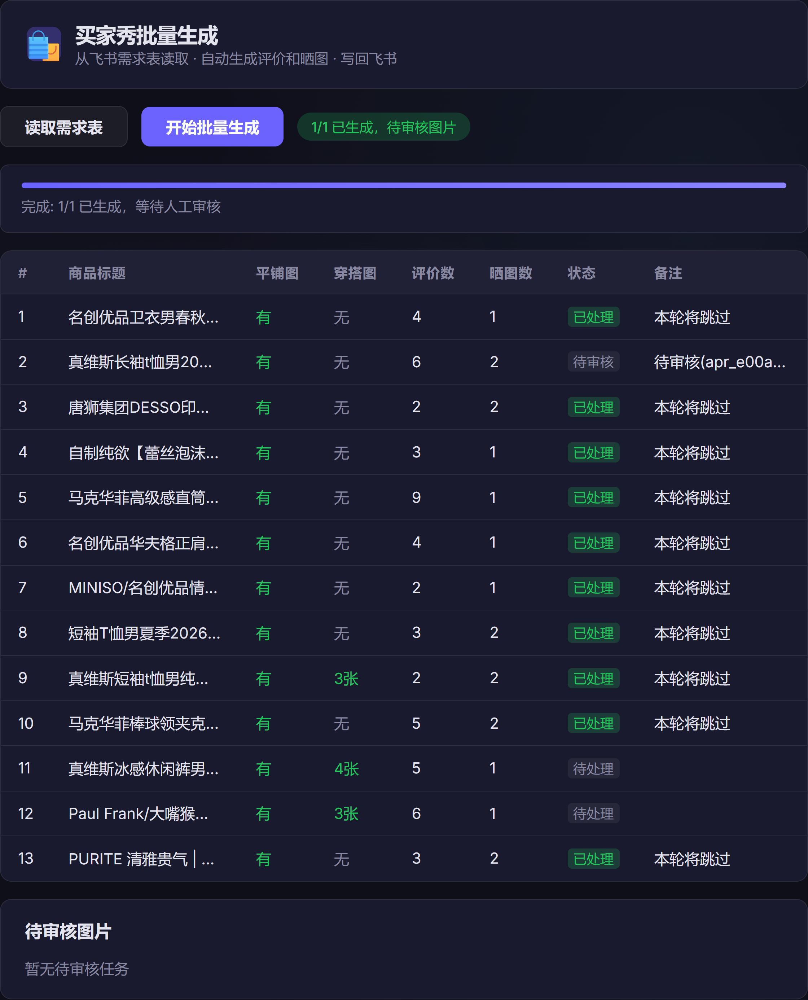

# 买家秀生成 Agent

<p align="center">
  
  
  
  
</p>

> 从飞书需求表到评价和晒图：给运营批量生成买家秀并写回飞书

<p align="center">
  
</p>

---

## 🎯 项目说明

运营在飞书多维表格里维护商品标题、平铺图、穿搭参考图、评价数量和晒图数量。本项目按行生成评价和买家秀图片，可选人工确认后写回飞书。商品信息只读表，不访问商品链接。

同一件商品的后续晒图会锁住已经通过的第一张：人物、地点和光线不动，只换机位。张数不齐或成图有硬伤时，结果留在控制台里人工确认，不会直接写回。

| 版本 | 功能 | 状态 | 文档 |
|-----|------|------|------|
| **V3 买家秀生成** | 读需求表、生成评价和晒图、可选人审、写回飞书 | ✅ 已完成 | [说明](agent.md) |

---

## 🚀 快速开始

下面的命令只在 **Windows 11 的 PowerShell** 里执行。

### 环境要求

- Python 3.12，用启动器 `py -3`。激活虚拟环境之前，直接输入 `python` 会走到 `WindowsApps` 里的占位程序，装不上依赖，也起不了服务
- Node.js（只在安装飞书命令行 `lark-cli` 时需要）
- 项目根目录的 `.env`：
  - `DASHSCOPE_API_KEY` 给评价、场景句和看图
  - `DOUBAO_API_KEY` 给豆包生图
  - `FEISHU_SOURCE_APP_TOKEN` 给需求表
  - `FEISHU_SOURCE_TABLE_ID` 给需求表
  - `FEISHU_APP_TOKEN` 给写回结果表
  - `FEISHU_TABLE_ID` 给写回结果表
  - `DASHSCOPE_BASE_URL` 给两个 Qwen 模型，默认 `https://maas.qianwenaiapi.com/compatible-mode/v1`
  - `QWEN_TEXT_MODEL` 给评价和场景句，默认 `qwen3.7-plus`
  - `QWEN_VISION_MODEL` 给看图，默认 `qwen3.8-omni-flash`
  - `REQUIRE_DELIVERY_CONFIRMATION` 给人审开关，默认 `false`
  - `BATCH_MAX_CONCURRENT` 给批量并发，默认 `3`

`QWEN_TEXT_MODEL=` 或 `QWEN_VISION_MODEL=` 这种等号后什么都没有的写法，空字符串会盖住上面的默认模型名。

飞书读写走本机 `lark-cli` 的用户身份，`.env` 里不放 `FEISHU_APP_SECRET`。

### 安装

只做一次。打开项目根目录，在资源管理器地址栏输入 `powershell` 后回车，确认窗口路径停在项目根目录，然后执行：

```powershell
py -3 -m venv .venv
.\.venv\Scripts\python.exe -m pip install -r requirements.txt
npx @larksuite/cli@latest install
```

`.venv` 已经存在时，跳过第一行。未安装 `lark-cli` 时，页面上的「读取需求表」会报 `未找到 lark-cli`。

### 启动 Web 服务

仍在项目根目录的 PowerShell 里。先激活虚拟环境，提示符前面出现 `(.venv)` 后再启动：

```powershell
.\.venv\Scripts\Activate.ps1
python app.py
```

Windows 11 默认禁止运行脚本时，上一行会报「无法加载文件 Activate.ps1，因为在此系统上禁止运行脚本」。只放行当前这个窗口，再激活、再启动：

```powershell
Set-ExecutionPolicy -Scope Process -ExecutionPolicy Bypass
.\.venv\Scripts\Activate.ps1
python app.py
```

终端出现 `Uvicorn running on http://127.0.0.1:8000` 后，浏览器打开该地址。页面上点「读取需求表」。停服务：在这个窗口按 `Ctrl+C`。

访问：**http://127.0.0.1:8000**

`8000` 已被占用时，终端报 `error while attempting to bind on address ('127.0.0.1', 8000)`，关掉占用该端口的旧窗口后再执行上面的启动命令。缺 `FEISHU_SOURCE_APP_TOKEN` 或 `FEISHU_SOURCE_TABLE_ID` 时，读取需求表会报 `FEISHU_SOURCE_APP_TOKEN / FEISHU_SOURCE_TABLE_ID 未配置`。用户登录态过期时，同一接口会报 `need_user_authorization`，在项目根目录重新执行 `lark-cli auth login --domain base --domain drive`。

---

## 📁 项目结构

```
maijiaxiu_agent/
├── README.md                  # 本文件（项目入口）
├── LICENSE                    # MIT
├── agent.md                   # 能力、模型、批量接口
├── requirements.txt           # Python 依赖
├── pytest.ini                 # 测试入口配置
├── app.py                     # Web 服务、审核接口
├── config.py                  # 从 .env 读取的配置
├── agent_graph_v2.py          # 单商品流程
├── agent_nodes.py             # 流程节点
├── agent_state.py             # 流程状态
├── agent_tools.py             # 评价生成
├── batch_graph.py             # 按行批量处理
├── image_generator.py         # 看图、场景句、生图、写回飞书
├── buyer_show_prompt.py       # 拍摄槽位和场景句
├── buyer_show_review.py       # 成图检查
├── qwen_client.py             # 千问接口
├── feishu_reader.py           # 读取需求表
├── lark_cli.py                # 调用本机 lark-cli
├── outbox.py                  # 审核记录
├── utils.py                   # 公共工具
├── diagnose_pipeline.py       # 本地诊断（默认不调用外部接口）
├── docs/                      # 控制台截图
│   └── console.png
├── static/                    # 批量处理页面
│   ├── index.html
│   ├── script.js
│   └── style.css
├── data/                      # 拍摄设定和示例
│   ├── buyer_show_slots.json
│   └── buyer_show_fewshots.json
└── tests/                     # pytest 用例
```

---

## 📖 文档导航

### 用户指南

| 文档 | 说明 |
|-----|------|
| [买家秀生成说明](agent.md) | 模型、生图规则、批量接口、核心文件 |

---

## ⚙️ 常用命令

在项目根目录的 PowerShell 里执行。跑测试和诊断前，先执行过 `.\.venv\Scripts\Activate.ps1`。

```powershell
# 安装依赖（虚拟环境已建好时）
.\.venv\Scripts\python.exe -m pip install -r requirements.txt

# 启动 Web 服务
.\.venv\Scripts\Activate.ps1
python app.py

# 跑测试
pytest

# 检查端口、导入和飞书字段解析，不调用模型和飞书接口
python diagnose_pipeline.py
```

---

## 🔮 项目演进

```
V3 买家秀生成 ✅（已完成）
```

---

## 📝 许可证

MIT

---

## 📧 联系方式

如有问题或建议，请联系 binggua666@gmail.com，或提交 Issue 或 Pull Request。

---

**最后更新**：2026-10-12
